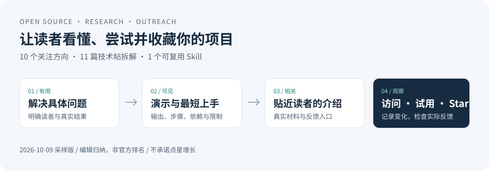

# GitHub 十大热门方向与开源项目传播 Skill

**研究别人做什么、怎样讲清价值，让自己的项目更容易被发现、上手和收藏。**

[](https://github.com/jiahehu2000-lgtm/open-source-growth-playbook/actions/workflows/check.yml)
[](LICENSE)




这份资料依据 **44 个 GitHub Trending 榜单条目、16 个仓库 API 核验、11 篇高互动技术帖**整理。
“十大”是编辑归纳的十个关注方向，编号不表示排名；所有热度数字都附采样时间与来源。

| 你想做什么 | 直接看这里 |
|---|---|
| 找到值得关注的方向与小项目切入点 | [十大热门方向](docs/十大热门方向.md) |
| 看高互动帖子实际做了什么、如何展示 | [11 篇内容拆解](docs/高赞帖内容拆解.md) |
| 让 AI 检查项目介绍、演示和上手过程 | [github-project-outreach Skill](skills/github-project-outreach/SKILL.md) |
| 判断改版后是否有真实增长 | [指标与观察方法](skills/github-project-outreach/references/measurement.md) |
| 核对样本和统计口径 | [采样方法与原始证据](docs/采样方法与证据.md) |

## 十个方向，先看能解决什么问题

| 方向 | 读者想得到的结果 | 代表项目 |
|---|---|---|
| AI 编码与审查 | 找到具体代码问题 | [OpenCodeReview](https://github.com/alibaba/open-code-review) |
| 专业 Skills 与插件 | 让现有 AI 可靠完成一件工作 | [mattpocock/skills](https://github.com/mattpocock/skills) |
| 多 Agent 协作 | 分工、交接和可见进度 | [paperclip](https://github.com/paperclipai/paperclip) |
| 记忆与上下文 | 找回项目决定并追溯来源 | [hindsight](https://github.com/vectorize-io/hindsight) |
| 文档 RAG 与知识库 | 从资料获得带出处的答案 | [WeKnora](https://github.com/Tencent/WeKnora) |
| 桌面自动化与受限运行 | 操作已有软件并明确访问范围 | [cua](https://github.com/trycua/cua) |
| 可编辑视觉与视频 | 得到可继续修改的输出 | [hyperframes](https://github.com/heygen-com/hyperframes) |
| 本地语音处理 | 在本机生成字幕、转写或配音 | [VoiceStudio](https://github.com/debpalash/VoiceStudio) |
| 低门槛本地推理 | 判断自己的硬件能否运行模型 | [colibri](https://github.com/JustVugg/colibri) |
| 实时地图与空间可视化 | 探索数据并核对来源 | [gods-eye-view](https://github.com/bilawalsidhu/gods-eye-view) |

完整指南为每个方向提供：**近期增星证据、实际需求、个人可做的小工具、第一份演示、内容写法和限制**。
当日样本偏向 AI；高互动帖还展示了硬件改造、教学游戏和本地办公工具等其他路线。

## Skill：改进项目，而不只改一个标题

`github-project-outreach` 会读取实际仓库，查找影响理解与使用的障碍，再按你的请求改进 README、
演示说明、中文推广材料和观察方法。附带的 Python 工具能保存公开 Stars/Forks 快照，并比较同一仓库的净变化。

### 安装

在支持 GitHub Skill 安装的 Codex 中，可以直接提出：

```text
从 https://github.com/jiahehu2000-lgtm/open-source-growth-playbook
安装 skills/github-project-outreach 这个 Skill。
```

手动安装：下载仓库，把整个 `skills/github-project-outreach` 文件夹放入自己的技能目录。
Codex 默认目录为 `$CODEX_HOME/skills/`；Windows 常见位置为 `%USERPROFILE%\.codex\skills\`。
如已有同名 Skill，先比较版本，避免覆盖自己的修改；安装后在新会话中使用。
其他支持 `SKILL.md` 的工具请遵循各自的技能目录与加载方式，不承诺通用兼容。
只安装 Skill 会取得技能、参考说明和快照脚本；十大方向与帖子原始证据留在本仓库，不是技能运行依赖。

### 使用

```text
使用 $github-project-outreach 检查这个仓库。
面向科研工作者改进中文 README，先展示真实输出，再给最短上手路径。
保留已有数据和代码，准备一份中文推广草稿，并列出需要核验的说法。
```

也可以只让它检查一个 README，或只整理当前热门方向；不会强制扩展成整套推广活动。
涉及向外部社区发帖时需单独授权。HN 当前不允许生成或 AI 编辑文本，Skill 仅准备事实材料，
由作者自行写最终 HN 帖子；本仓库的方向清单也不属于可体验的 Show HN 项目。

### 保存点星基线

在仓库根目录运行，要求 Python 3.10+，只使用标准库，无需访问令牌：

```bash
python skills/github-project-outreach/scripts/github_snapshot.py capture owner/repo --output outputs/baseline.json
# 在一个明确的观察期之后，再运行：
python skills/github-project-outreach/scripts/github_snapshot.py capture owner/repo --output outputs/later.json
python skills/github-project-outreach/scripts/github_snapshot.py compare outputs/baseline.json outputs/later.json --output outputs/change.json
```

输出保留 UTC 时间、仓库 ID、Stars 与 Forks。网络失败记为错误，既有文件不覆盖，净增允许为负。
两次计数只能说明观察期净变化，不能证明某个帖子带来了这些 Stars。

## 我们最值得借鉴的内容

高互动案例通常把**具体问题、真实效果、可体验示例、最小步骤、技术依据与限制**放在一起。
这是一组可以尝试的做法，未经过增星因果实验。高积分帖子也可能存在激烈批评；Stars、评论量和实际使用人数应分别判断。

对小型科研工具，首屏展示可编辑输出、运行样例和支持环境，通常比泛泛罗列“AI、自动化、强大”更有信息价值。
实际应用可看我们的 [Origin 科研绘图 Skill](https://github.com/jiahehu2000-lgtm/origin-scientific-plotting)
和 [光突触 RC 计算示例](https://github.com/jiahehu2000-lgtm/photo-synapse-rc)。这是展示方式的实践链接，未宣称已获得传播增长。

如果资料或 Skill 对你有用，欢迎 Star 留作以后查阅，也欢迎提出带来源的补充与纠错。
所有基本资料直接开放，不需要先点星。

## 维护、复现与许可

原始证据在 `data/`，日期固定在 2026-10-09。趋势会变化，本版不会把旧快照伪装成实时排名。
重新整理时应先补采公开证据、审视方向分类，再运行 `python scripts/build_reports.py` 更新两篇报告；
该脚本只使用已有数据，不会自动抓取榜单或发帖。

```bash
python -m pip install -r requirements-dev.txt
python -m unittest discover -s tests -v
python scripts/validate_package.py
```

原创说明与代码采用 [MIT](LICENSE)。所引用项目、帖子和第三方软件仍遵循其原有许可；
这里的汇总不转授它们的代码、品牌或内容权利。

English: dated GitHub trend research, technical launch case studies, and a reusable project-outreach Skill.
The ten topics are an editorial selection, not an official ranking. Improve real value and onboarding; measure voluntary Stars without promising growth.
